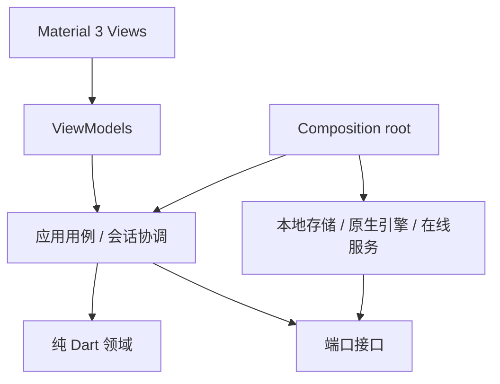

# 架构设计基线（P，未实现）

采用功能模块 + MVVM 表现层 + 纯 Dart 领域 + 端口适配器。参考 [Flutter 架构指南](https://docs.flutter.dev/app-architecture/guide)，复杂象棋规则独立领域层。依赖指向领域/接口，composition root 唯一装配具体实现。

## 模块与所有权

| 模块（未来路径） | 拥有的数据和职责 | 禁止依赖 |
|---|---|---|
| lib/domain/xiangqi | Piece、Square、Position、Move、FEN、合法走法、RuleProfile、终局裁决 | Flutter、网络、存储、引擎 |
| lib/domain/game_tree | GameDocument、GameNode、分支、注释、标签、游标 | 视图坐标、native |
| lib/application/session | 模式、脏状态、命令、撤销、positionRevision | Widget、具体适配器 |
| lib/application/analysis | 搜索调度、分数归一化、MultiPV、复盘任务 | FFI 细节 |
| lib/ports | EngineGateway、GameRepository、MoveSpeechPort、AudioFeedbackPort、BookService、RecognitionService、SyncService、PlatformFiles | 插件实现 |
| lib/adapters/engine | Process/FFI、UCI 编解码、崩溃恢复 | UI |
| lib/adapters/storage | SQLite候选、schema迁移、事务、草稿 | Widget |
| lib/adapters/online | 认证、超时、缓存、重试、服务 DTO | UI |
| lib/features/*/presentation | board/editor/library/review/training/settings 的 View/ViewModel | native、HTTP、SQL |
| lib/design_system | 色彩、排版、适配、可访问组件 | 业务仓储 |
| lib/app | 路由、依赖装配、生命周期 | 不放领域规则 |
| native/pikafish | 固定上游、最小 C ABI、构建补丁与许可 | Dart UI |

状态管理先用可替换 ViewModel 接口，Riverpod 为候选而非已锁定依赖。路由、SQLite、文件选择插件在 M1 核对当前版本/许可证后 ADR 锁定，避免纸面依赖承诺。

## 核心契约

EngineGateway: capabilities、initialize(config)、start(position + history, limits, token)、stop(reason)、events、dispose。事件携带 engineEpoch/searchToken/positionRevision。EngineCapabilities 由握手选项产生；unsupported 功能在 UI 禁用并解释。EngineConfig 与 PlayStrength 分开，禁止假设 Skill Level 存在。

GameRepository: 草稿事务、显式保存、按 id 读取、分页检索、删除恢复、schemaVersion；导入文档先验证后提交。GameNode 使用稳定 ID、parentId、有序 children、move、comment；局面由根 FEN + 路径得到，可缓存但不重复作为主数据。

BookService.query(PositionKey) 返回 moves/source/fetchedAt/status，不直接落子；应用层决定来源优先级和合法性。RecognitionService 只返回候选局面和置信度，不覆盖会话。SyncService 用 revision/baseRevision 检测冲突，保留双方副本而非最后写入覆盖。

## 一致性

UI 是状态投影，唯一会话协调器提交命令。一次导入或新局只更新一次文档 revision；存储失败维持 dirty。持久化包括文档 schema、规则 profile、引擎/网络版本、分析配置和评分视角，使复盘可解释。账号 token 存平台安全存储，日志不含棋谱正文/凭据，遥测默认关闭（项目提案）。

## 平台边界

桌面用 Process 隔离故障；移动尝试嵌入原生库，经工作线程/Isolate 通信。生命周期、分享、文件、相机、窗口菜单为平台适配器。iOS 静态链接与构建 hooks 的适用性必须真机 spike；不把桌面进程方案套用到手机。

## 2026-11-01 离线落地细化

范围权威为 planning/OFFLINE_SCOPE。暂不实例化Auth/Sync/CloudBook/RemoteRecognition；使用明确 unavailable 能力而不是假数据。保留端口可替换，不在UI调用网络。

生产工程建议保持单Flutter应用 + 独立纯Dart领域package + 引擎端口package + native桥接package；先按目录边界组织，只有跨运行时和独立测试价值才拆包。当前 research/spikes/flutter_engine_probe 是可丢弃验证，不直接搬成生产框架。

数据流：View发Intent→SessionController验证领域命令→提交GameDocument revision→Repository事务保存→AnalysisCoordinator串行取消旧搜索/排新搜索→EngineGateway事件→校验epoch+revision→AnalysisState→View。游标与棋盘朝向属于会话/展示，不变更棋谱根局面；编辑草稿与正式文档隔离。

调度优先级：用户对弈搜索 > 当前局面分析 > 整谱后台复盘。共用单引擎实例，抢占先stop/drain，不重入go；只在当前请求有效时落子。退出/后台先停搜索，保存草稿；恢复不自动落子。高频info合并到约10Hz UI刷新，bestmove/error不节流丢弃。

分析缓存key = 规范化根局面+完整相关走子历史+规则profile+引擎SHA+网络SHA+搜索配置（history对重复裁决重要，不能只FEN）。保存score原始cp/mate/bound与sideToMove，展示时独立归一化；复盘算法版本单独存储，阈值未校准不标“准确率”。

技术候选：内置ChangeNotifier/ViewModel可支撑第一垂直切片；引入Riverpod需独立ADR说明收益。SQLite/Drift作为存储候选，文件/分享/权限插件在选用时核实版本、五平台能力和许可证。当前spike只有SDK/Flutter测试依赖，未锁生产生态。

引擎难度端口接收预算策略而非虚构SkillLevel；RuleService独立裁决，向不具规则切换能力的引擎发送合法且有历史的局面。UI呈现unsupported能力，禁止让任意setoption文本直通native。

## M2-01实际落地路径

纯Dart领域已在 packages/xiangqi_core 独立包实施，对应上文规划lib/domain/xiangqi的规则职责；生产Flutter应用后续通过path依赖使用，不复制规则代码。接口采用不可变Position/Move/Square，play负责合法性，FEN解析与编辑语义校验分层。当前legalMoves为无历史的棋盘合法性，不能作为完整规则profile裁决替代。

M4-05 增加的 AnimationSpeed 是本机展示偏好，不进入规则/棋谱/引擎端口；Composition root 将不可变值注入 BoardDisplayScope，最后一步标记按新局面变化使用时长。四档时长属于项目映射且仅覆盖光圈，见 ADR-042。

M4-06的BoardFeedbackController是BoardSession与AudioFeedbackPort间的应用层事件翻译；偏好开关驱动，不向规则、GameTree或UCI发送音频依赖。生产root仅注入AudioplayersFeedback，组件/领域测试用静音或fake端口。播放器异常是可选副作用并隔离，不改变已提交着法。见ADR-043。

M4-08由BoardFeedbackController按已提交节点的父局面计算ChineseNotation，并通过独立MoveSpeechPort请求系统朗读，不复用AudioFeedbackPort或走棋音效开关。FlutterTtsMoveSpeech只在官方插件已声明的平台并发现已安装中文voice时播报；Android跳过标记联网语音，Linux/Web保持静音。可用性/异常不影响棋局。见ADR-044。
## M4-09：自定义本机音效边界

`AudioOptionsDialog` 经 `AudioLibraryController` 调用 `AudioFilePicker`、`AudioOverrideRepository`，不直接访问文件系统；播放器仍通过独立 `AudioFeedbackPort` 查询 overrides 并使用 `DeviceFileSource`。默认素材由应用bundle资产提供。存储适配器仅使用 application support 受控子目录和严格清单文件名，临时目录完成写入后替换清单。WAV/MP3验证留在纯Dart应用层；文件选择适配器在读取时也限制512KiB。新设置不可达时音效维持默认。

M4-10只给走棋事件添加独立 `MoveSoundChoice` 偏好；走棋系统音效在有自定义文件时先使用用户文件，否则读取持久化预设；其它事件仍走各自音效。`AudioSoundPreviewPort`负责试听指定预设，不暂时改写当前值。M4-13之后，随皮肤选项按PieceSkin解析音效1/2，详ADR-049。

M4-14的棋子图片流程采用`PieceImagePicker`/`PieceImageRepository` ports，由`PieceImageLibraryController`串接校验和本地持久化；UI只读控制器状态，图像解析/业务失败类型不依赖Flutter。选图后先执行容量、PNG/JPEG头部尺寸及真实解码校验，再由仓库写入每皮肤独立目录和受限JSON清单。`BoardDisplayScope`仅提供当前皮肤只读图片；PNG/GIF快照复制bytes并冻结，避免偏好之后变动影响导出。当前限制512 KiB、1024边长及1MP，批量归档导入另行设计。

M4-15皮肤缩放数值作为`AppPreferences`中两个稳定字段按PieceSkin分别持久化；异步偏好加载遵循既有edited-fields合并屏障。`BoardDisplayScope`只暴露当前皮肤比例，UI不操作棋盘绘制器；单面容比例和全局比例在展示端组合，图片/GIF快照则冻结原始两个因子。范围80–120为项目P，不复刻参考站未知最小端点。

M4-16预设位置同样是schema1的四个独立偏好字段。展示端以每格宽百分比将棋子绘制层视觉平移，始终设置`transformHitTests:false`；Navigator、领域棋谱与棋盘交点不感知装饰性偏移。BoardDisplayScope和图片/GIF冻结快照各自持有只读值，方向按钮通过PreferencesController的有界更改入口持久化，自动对正写回零值。

## M4-39：自建公开皮肤目录服务端

`server/skin_catalog`是独立纯Dart只读HTTP服务；进程启动时读取发布目录JSON，通过固定ID/文件路径映射皮肤包，不接触用户棋谱/账号，不提供上传或投票写接口。列表排序/搜索/分页由服务使用有界参数执行；详情声明许可证/署名，ZIP以SHA-256校验并返回ETag。服务不编造清单条目；运营者离线更新发布目录，TLS/反代和速率限制由部署层提供。Flutter客户端应经独立`PieceSkinCatalog`端口装配服务URL、缓存/超时及明确离线错误，不允许UI直接持HTTP/JSON。

## M4-40：皮肤目录客户端传输层

客户端经`PieceSkinCatalog`端口读取自建目录，数据含许可/署名与包哈希。HTTP适配器限定HTTPS远端（loopback允许HTTP本机部署）、8秒超时、分页/搜索边界和2MiB响应体；网络不可达与HTTP/协议错误有类型区别。端口目前未接入UI、可配置URL、缓存或包下载导入，见ADR-075。

## M4-41：在线皮肤目录浏览

AppPreferences记忆自建目录URL，PreferencesController验证并保护异步读取时用户新改值。皮肤库经`PieceSkinCatalog`查询和分页，展示服务条目许可/署名；断网和空目录都明确呈现。条目详情不自动下载或写入，下载/校验/导入留M4-42。见ADR-076。

## M4-42：目录皮肤包下载和本机导入

目录端口按预期SHA-256下载有界ZIP，`PieceSkinPackageCodec`完成二次结构校验；随后要求用户确认许可/署名，再由PieceSkinLibraryController安全导入。PieceSkinDefinition保存license/attribution并随本机清单/导出包保留。取消/失败无写入。见ADR-077。

## M4-44：自建目录页离线缓存

`HttpPieceSkinCatalog`仅缓存协议完整校验的目录页，由`PieceSkinCatalogCache`端口注入文件存储适配器。查询键包含服务地址及搜索/排序/页码参数；存储名仅使用SHA-256。最多24页，每页2MiB，临时文件替换；网络不可达时按完全相同查询键返回旧页，并在界面显示“离线缓存”和抓取时间。HTTP拒绝及无效响应不会用旧数据覆盖，包仍需下载校验和用户许可确认。缓存不设置隐式过期，用户明确看到旧内容时间。见ADR-078。

## M4-45：本机多棋子皮肤集合ZIP

`PieceSkinCollectionPackageCodec`组合既有schema1单皮肤包并逐个调用其解码器；所有路径/压缩条目/SHA/图片在选择UI前整体校验。用户选中的本机皮肤可打成集合ZIP导出；导入后用户可选子集，显示许可/署名并跳过同名，加入新ID。应用层批量安装图片后只提交一次皮肤定义列表；失败时清理所有已暂存图片。项目格式最多16套且整体8MiB。未知参考站多套压缩包格式仍U，不声称兼容。见ADR-079。
