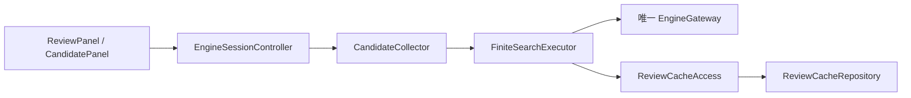

# ADR-014 整谱多候选与局面完成边界

2026-11-02，F32/B18，E12/E13/E14。UI提供最佳着法与多候选模式；每候选预算、数量策略和源站未知筛选边界沿ADR-013，不把多个合法候选称为已经复刻所有可接受算法。

CandidateCollector为纯应用服务，单步与整谱共用逐次排除/有限搜索，调用FiniteSearchExecutor；会话协调器独占一个EngineGateway。整谱不得内部调用startCandidates来启动第二会话，否则会disable自己的队列。节点目标始终来自不可变tree快照，读谱允许继续，内容修订/新文档/AI或分析抢占仍取消并过期。

ReviewRun记录ReviewMode、最多候选、当前候选序号/上限、每节点ReviewedCandidates。后者entries不可变且有complete标记；只有收尾完成才加入results和完成局面计数。取消保留已完成的单次候选为partial，可读详情但不冒充完整局面。第一条无约束最佳请求的评分用于图形/主评分；它无分时保持无分，不以之后受限搜索分数替代。终局不伪造评分。

缓存仍按每个精确子查询（历史/身份/预算/允许集）保存，不额外创造整组集合缓存。最佳模式的第一查询可用于多候选第一查询；max变化时只跳过实际已有的子查询，继续补齐。mode/max是集合完成条件，不改变等价单次查询的best-pv-v1含义；未来筛选/引擎选项实际变更必须更新版本或键，不能静默混用。

cachedCount仅表示本次该局面的所有查询均由缓存提供；cachedSearchCount统计已完成候选查询命中次数。若命中一条后又实际查询但引擎无更多着法，不算整局面全部复用。不得把4局面×2候选的8次命中显示为8个局面。

工作中info仅用于统一100ms节流的batchInfo，token/job双重验证；切候选/取消/失败/销毁清理计时器，不复制最终评分捕获逻辑。候选详情对话框有界虚拟列表/自适应高度/可滚动大字，部分结果明确标记。当前整谱详情只读；原子试走仍通过单步候选模块，不从展示层直接导航后落子。

实际验证与失败修正见TRACEABILITY/SESSION_LOG。胜率/准确率/分类/错题、规则历史和其他平台仍后续，不标F32全部完成。
